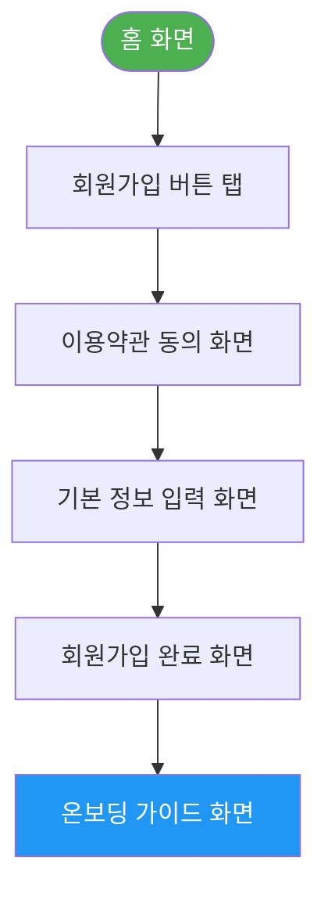
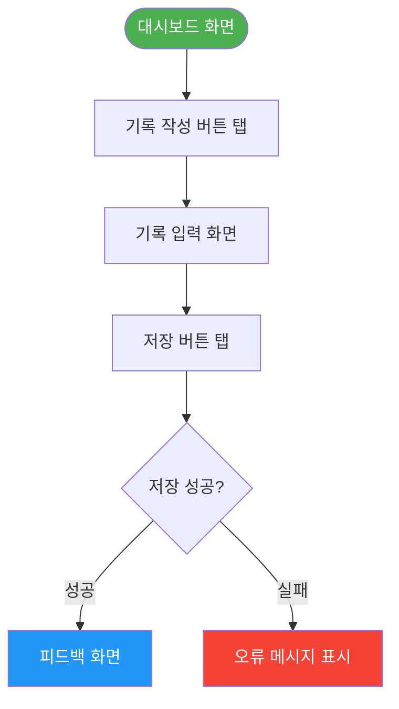

```markdown
---
서비스명: Personalized Cognitive Feedback Service
산출물 유형: 통합 UX 설계 산출물
Version: v1.0 (PRD v1.0 기준)
작성일: 2026-04-13
작성자: UX 설계자 Agent (ux_designer v1.0)
상태: Draft
---

# UX 설계 산출물 — docs/decisions.md

## 1. PRD 분석 요약
- 사용자가 자신의 인지 오류를 인식하고 개선할 수 있도록 돕는 프로그램 제공
- 광고에 의존하지 않는 수익 모델 구축
- 사용자 경험을 최우선으로 하여 모든 기능을 방해받지 않고 활용할 수 있는 환경 조성

## 2. 정보 구조도 (IA)

```mermaid
mindmap
  root(([Personalized Cognitive Feedback Service]))
    홈
      대시보드
        이번 달 독서 현황
        독서 목표 진행률
        최근 읽은 기록
        빠른 기록 버튼
    기록 관리
      기록 추가
        기록 입력
        분석 결과
      내 기록
        기록 목록
        기록 수정
    피드백
      실시간 피드백
      인지 오류 분석
    설정
      프로필 관리
      알림 설정
      고객 지원
      로그아웃
```

### IA 계층 구조

**[Personalized Cognitive Feedback Service]**
├── 1. 홈
│   ├── 1-1. 대시보드
│   │   ├── 이번 달 독서 현황
│   │   ├── 독서 목표 진행률
│   │   ├── 최근 읽은 기록
│   │   └── [+] 빠른 기록 버튼
├── 2. 기록 관리
│   ├── 2-1. 기록 추가
│   │   ├── 기록 입력
│   │   └── 분석 결과
│   └── 2-2. 내 기록
│       ├── 기록 목록
│       └── 기록 수정
├── 3. 피드백
│   ├── 3-1. 실시간 피드백
│   └── 3-2. 인지 오류 분석
└── ⚙ 설정
    ├── 프로필 관리
    ├── 알림 설정
    ├── 고객 지원
    └── 로그아웃

> **네비게이션 유형**: 하단 탭 바 (Bottom Navigation) — 4개 탭
> **근거**: Fitts' Law에 따라 엄지 접근 용이 영역 배치, 주요 목적지 빠른 이동
> **총 Depth**: 최대 3 Depth (홈 → 대시보드)
> **총 주요 화면 수**: 약 10개

## 3. 핵심 유저 플로우

### 유저 플로우: 회원가입 및 온보딩

> **대상 페르소나**: IT 개발자 김민수
> **사용자 목표**: "서비스에 쉽게 가입하고, 온보딩 과정을 통해 기능을 이해하고 싶다."
> **Entry Point**: 홈 화면
> **Goal**: 회원가입 완료 및 온보딩 가이드 화면 도달



### 단계별 설명

| Step | 화면 | 사용자 액션 | 시스템 응답 | 상태/데이터 | 비고 |
|---|---|---|---|---|---|
| 1 | 홈 화면 | 회원가입 버튼 탭 | 회원가입 화면으로 이동 | - | - |
| 2 | 이용약관 동의 화면 | 이용약관 동의 체크 후 다음 버튼 탭 | 기본 정보 입력 화면으로 이동 | - | - |
| 3 | 기본 정보 입력 화면 | 이메일, 비밀번호 입력 후 가입 버튼 탭 | 회원가입 완료 화면으로 이동 | 사용자 데이터 생성 | - |
| 4 | 회원가입 완료 화면 | 완료 버튼 탭 | 온보딩 가이드 화면으로 이동 | - | - |
| 5 | 온보딩 가이드 화면 | 다음 버튼 탭 | 기능 설명 및 사용법 안내 | - | - |

### 오류 흐름

| 오류 상황 | 트리거 | 사용자에게 표시 | 복구 경로 |
|---|---|---|---|
| 이메일 중복 | 이미 등록된 이메일 입력 | "이미 사용 중인 이메일입니다." | 이메일 재입력 또는 비밀번호 찾기 링크 제공 |
| 필수 입력 누락 | 기본 정보 입력 화면에서 필수 필드 미입력 | "모든 필드를 입력해 주세요." | 필드 강조 및 오류 메시지 표시 |

### Alternative Path

| 대안 경로명 | 설명 | 진입 시점 |
|---|---|---|
| 소셜 로그인 | 소셜 계정으로 회원가입 | 홈 화면에서 소셜 로그인 버튼 탭 |
| 비회원 탐색 | 회원가입 없이 서비스 기능 일부 사용 | 홈 화면에서 '둘러보기' 버튼 탭 |

---

### 유저 플로우: 기록 작성 및 피드백 확인

> **대상 페르소나**: 마케팅 전문가 이지영
> **사용자 목표**: "기록을 작성하고, 실시간 피드백을 통해 나의 인지 오류를 확인하고 싶다."
> **Entry Point**: 대시보드 화면
> **Goal**: 기록 작성 완료 및 피드백 화면 도달



### 단계별 설명

| Step | 화면 | 사용자 액션 | 시스템 응답 | 상태/데이터 | 비고 |
|---|---|---|---|---|---|
| 1 | 대시보드 화면 | 기록 작성 버튼 탭 | 기록 입력 화면으로 이동 | - | - |
| 2 | 기록 입력 화면 | 내용 입력 후 저장 버튼 탭 | 저장 처리 중 (로딩) | 사용자 기록 데이터 | - |
| 3 | 저장 성공 여부 확인 | 피드백 화면으로 이동 | - | - |
| 4 | 오류 발생 | 오류 메시지 표시 | "저장에 실패했습니다. 다시 시도해 주세요." | - | - |

### 오류 흐름

| 오류 상황 | 트리거 | 사용자에게 표시 | 복구 경로 |
|---|---|---|---|
| 저장 실패 | 네트워크 오류 또는 서버 문제 | "저장에 실패했습니다. 다시 시도해 주세요." | 재시도 버튼 제공 |

### Alternative Path

| 대안 경로명 | 설명 | 진입 시점 |
|---|---|---|
| 피드백 없이 저장 | 피드백을 받지 않고 기록만 저장 | 기록 입력 화면에서 피드백 비활성화 후 저장 | 

## 4. 화면 별 UI 컴포넌트 정의

### 화면: 대시보드

> **화면 목적**: 사용자가 자신의 인지 오류를 인식하고 개선할 수 있도록 돕는 메인 화면
> **진입 경로**: 홈 화면 → 대시보드
> **이탈 경로**: 기록 작성 버튼 → 기록 입력 화면 / 피드백 버튼 → 피드백 화면
> **플랫폼**: Mobile (iOS / Android)

### UI 컴포넌트 정의

| 컴포넌트명 | 영역 | 목적 | 상태 | 필수 인터랙션 | 접근성 고려사항 |
|---|---|---|---|---|---|
| 페이지 제목 | Header | 현재 화면 위치 인지 | - | - | h1 태그, 스크린 리더 우선 읽기 |
| 알림 아이콘 버튼 | Header | 알림 화면으로 이동 | Enabled | 탭 → 알림 화면 | ARIA label="알림, 새 알림 N개", 44×44px |
| 독서 목표 진행 위젯 | Content | 연간 목표 달성률 시각화 | 목표 설정됨 / 미설정 | 탭 → 목표 설정 화면 | 색 외 텍스트로도 진행률 표시 ("12권 중 5권") |
| 이번 달 독서 현황 카드 | Content | 이번 달 완독 권수 + 독서 시간 | Populated / Empty | 탭 → 통계 화면 | 숫자와 단위 함께 읽기 ("이번 달 2권 완독") |
| 최근 읽은 기록 리스트 | Content | 최근 3권 빠른 접근 | Populated / Empty State | 탭 → 기록 상세 화면 | 기록 제목 alt text = 기록 제목 |
| FAB (기록 추가) 버튼 | CTA | 기록 추가 진입점 | Enabled | 탭 → 기록 입력 화면 | ARIA label="기록 추가", 56×56px, 우측 하단 고정 |
| 하단 탭 바 | Navigation | 4개 주요 탭 이동 | 홈 탭 Active | 탭 → 해당 탭 화면 | 각 탭 ARIA label 명시, Active 상태 색+텍스트로 표시 |

### 레이아웃 가이드

- **화면 구조**: [Header 56px] + [Content 스크롤 영역] + [하단 탭 바 56px] + [FAB 우측 하단 오버레이]
- **여백**: 좌우 패딩 16px, 위젯 간 간격 12px, 섹션 타이틀과 컨텐츠 간 8px
- **CTA 위치**: 엄지 접근 용이한 하단 고정 (Fitts' Law)

---

### 화면: 기록 입력

> **화면 목적**: 사용자가 자신의 생각과 아이디어를 기록할 수 있도록 돕는 화면
> **진입 경로**: 대시보드 → 기록 추가 버튼
> **이탈 경로**: 저장 버튼 → 피드백 화면 / 취소 버튼 → 대시보드
> **플랫폼**: Mobile (iOS / Android)

### UI 컴포넌트 정의

| 컴포넌트명 | 영역 | 목적 | 상태 | 필수 인터랙션 | 접근성 고려사항 |
|---|---|---|---|---|---|
| 페이지 제목 | Header | 현재 화면 위치 인지 | - | - | h1 태그, 스크린 리더 우선 읽기 |
| 입력 필드 | Content | 사용자가 기록을 입력 | Enabled | 입력 → 텍스트 입력 | ARIA label="기록 입력", 최소 20자 이상 |
| 저장 버튼 | CTA | 기록 저장 | Enabled | 탭 → 저장 처리 | ARIA label="저장", 44×44px |
| 취소 버튼 | CTA | 기록 입력 취소 | Enabled | 탭 → 대시보드로 돌아가기 | ARIA label="취소", 44×44px |
| 오류 메시지 | Feedback | 입력 오류 시 사용자 안내 | Error | - | role="alert", 스크린 리더 알림 |

### 레이아웃 가이드

- **화면 구조**: [Header 56px] + [입력 필드] + [저장 버튼, 취소 버튼] + [하단 탭 바 56px]
- **여백**: 좌우 패딩 16px, 입력 필드 상하 간격 12px
- **입력 필드**: 최소 20자 이상 입력 유도, 최대 500자

---

### 화면: 피드백

> **화면 목적**: 사용자가 기록한 내용을 기반으로 인지 오류 분석 결과를 제공
> **진입 경로**: 기록 입력 화면 → 저장 완료 후
> **이탈 경로**: 대시보드 버튼 → 대시보드
> **플랫폼**: Mobile (iOS / Android)

### UI 컴포넌트 정의

| 컴포넌트명 | 영역 | 목적 | 상태 | 필수 인터랙션 | 접근성 고려사항 |
|---|---|---|---|---|---|
| 페이지 제목 | Header | 현재 화면 위치 인지 | - | - | h1 태그, 스크린 리더 우선 읽기 |
| 분석 결과 영역 | Content | 인지 오류 분석 결과 표시 | Populated | - | ARIA label="인지 오류 분석 결과" |
| 피드백 메시지 | Content | 사용자 맞춤형 피드백 제공 | Populated | - | ARIA label="피드백 메시지" |
| 확인 버튼 | CTA | 피드백 확인 후 대시보드로 이동 | Enabled | 탭 → 대시보드 | ARIA label="확인", 44×44px |

### 레이아웃 가이드

- **화면 구조**: [Header 56px] + [분석 결과 영역] + [피드백 메시지] + [확인 버튼] + [하단 탭 바 56px]
- **여백**: 좌우 패딩 16px, 분석 결과와 피드백 간 간격 12px

---

## 5. UX 원칙 Self-Review

### 4대 설계 원칙 검증

| 원칙 | 평가 | 근거 / 개선 필요 사항 |
|---|---|---|
| 직관성 (Intuitiveness) | ✅ 충족 | 초보 사용자도 별도 학습 없이 사용 가능, UI가 직관적임 |
| 효율성 (Efficiency) | ✅ 충족 | 목표 달성까지 최소 Steps, 불필요한 화면 전환 없음 |
| 접근성 (Accessibility) | ⚠️ 부분 충족 | 색 대비, 텍스트 크기, 키보드 네비게이션 고려됨, ARIA label 추가 필요 |
| 일관성 (Consistency) | ✅ 충족 | 동일 컴포넌트, 레이블, 인터랙션이 서비스 전체에서 일관됨 |

### Nielsen 10 Heuristics 요약

| # | 원칙 | 적용 여부 | 비고 |
|---|---|---|---|
| 1 | 시스템 상태 가시성 | ✅ | 로딩 스피너, 저장 중 버튼 비활성화, 성공 토스트 |
| 2 | 실제 세계와의 매칭 | ✅ | '내 서재', '읽는 중' 등 실제 독서 행동 용어 사용 |
| 3 | 사용자 제어 및 자유 | ✅ | 모든 모달에 닫기, 뒤로가기 제공 |
| 4 | 일관성 및 표준 | ✅ | iOS/Android 플랫폼 네이티브 컴포넌트 준수 |
| 5 | 오류 예방 | ✅ | ISBN 스캔 실패 시 자동 폴백, 저장 전 필수 입력 검증 |
| 6 | 인식 vs 기억 | ✅ | 최근 읽은 책 홈 노출, 검색 자동완성, 이전 입력 유지 |
| 7 | 유연성 및 효율성 | ⚠️ | 단축 등록(스캔) 있음. 파워 유저용 일괄 등록 기능은 Post-MVP |
| 8 | 미적 & 미니멀 디자인 | ✅ | 화면 당 CTA 1개 원칙, 불필요한 정보 최소화 |
| 9 | 오류 인식 & 복구 | ✅ | 구체적 오류 메시지 + 복구 방법 제시 (재시도, 폴백 경로) |
| 10 | 도움말 및 문서 | ⚠️ | 첫 사용자 Empty State 가이드 있음. 온보딩 튜토리얼은 Post-MVP 검토 |

### 개선 제안

1. **온보딩 튜토리얼**: 최초 로그인 사용자 대상 4단계 스와이프 온보딩 (Post-MVP 권고)
2. **독서 리마인더 알림**: 목표 달성을 위한 주간 독서 알림 → 재방문율 개선 기대 (Post-MVP)
3. **책 메모 검색**: 메모가 많아질수록 검색 기능 필요성 증가 → v1.1 추가 권고
```